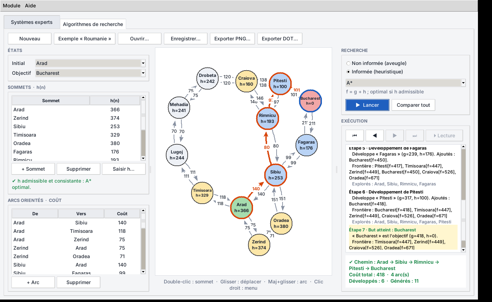

# IA & ML — Assignment 1 : Systèmes experts et algorithmes de recherche

Application interactive (Python, **aucune dépendance obligatoire**) en **interface graphique (Tkinter)** ou en **ligne de commande**, avec deux modules :

1. **Systèmes experts** — base de faits + base de règles, chaînage avant et arrière, trace pas à pas.
2. **Algorithmes de recherche** — graphe orienté pondéré construit par l'utilisateur, 5 algorithmes aveugles et 4 informés, visualisation graphique.

## Prérequis

- Python **3.10+** (Tkinter pour la GUI : inclus avec Python sur Windows/macOS ; Linux : `sudo apt install python3-tk`)
- *(optionnel)* `matplotlib` pour la visualisation graphique (sinon : affichage texte + export Graphviz DOT)
- *(optionnel)* `pytest` pour lancer les tests

## Installation

```bash
python -m venv .venv
source .venv/bin/activate            # Windows : .venv\Scripts\activate
pip install -e ".[dev]"              # ou simplement : pip install matplotlib pytest
```

## Exécution

```bash
python run.py --gui                  # interface graphique (recommandé pour la démo)
python run.py                        # mode console
# ou, après pip install -e . :
ia-app-gui                           # GUI
ia-app                               # console  (ou : python -m ia_app [--gui])
```

Options : `--gui`, `--no-color` (console), `--version`.

## Interface graphique

Deux onglets (menu **Module**, `Ctrl+1` / `Ctrl+2`) équivalents au menu principal.



- **Systèmes experts** : listes de faits et de règles éditables, objectif (avec statut « déjà dans la base »), choix avant/arrière, **Précédent / Suivant / Tout afficher / Lecture auto**, trace colorée et indentée, faits déduits, conclusion.
- **Recherche** : graphe **interactif** — double-clic = nouveau sommet, glisser = déplacer, **Maj + glisser** = créer un arc, clic droit = initial / objectif / supprimer. Les sommets sont colorés étape par étape (initial, objectif, frontière, explorés, sommet courant) et le **chemin final est surligné**. Panneaux h(n) et arcs éditables (double-clic), lecteur d'étapes, bouton **Comparer tout**, export PNG / DOT, ouverture / sauvegarde JSON.

```
MENU PRINCIPAL
  1. Systèmes experts
  2. Algorithmes de recherche
  3. Quitter
```

## Module 1 — Systèmes experts

| Menu | Fonction |
|---|---|
| Afficher la base | faits initiaux + règles sous la forme `R5 : SI a ET b ALORS c` |
| Choisir l'objectif | indique si le fait est **déjà dans la base** ; modifiable à tout moment sans relancer |
| Choisir la méthode | chaînage **avant** ou **arrière** |
| Lancer le raisonnement | trace numérotée, **pas à pas** (Entrée = suivant, `a` = tout afficher) ou direct |
| Personnaliser | ajouter / supprimer des faits, ajouter / modifier / supprimer des règles |
| Sauvegarder / charger | base de connaissances au format JSON |

Saisie d'une règle : `SI a ET b ALORS c`, `a, b -> c` ou `a & b => c`. Les faits sont insensibles à la casse.
Un exemple (identification d'animaux) est chargé au démarrage ; objectif conseillé : `guepard`.

## Module 2 — Algorithmes de recherche

1. **Construire le graphe** : sommets, arcs orientés avec coût (≥ 0), état initial / objectif, heuristique h(n) (avec contrôle d'**admissibilité** et de **consistance**).
2. **Lancer une recherche** : catégorie → algorithme → exécution pas à pas (sommet développé, frontière, explorés), chemin, **coût total**, ou message « aucun chemin ».
3. **Visualiser** : fenêtre matplotlib, PNG, export DOT, ou une image par étape (`out/frames/`) pour la vidéo.
4. **Comparer** tous les algorithmes (trouvé, coût, nœuds développés, chemin, ★ optimal).
5. **Sauvegarder / charger** le graphe en JSON ; l'exemple « Roumanie » (Arad → Bucharest) est inclus.

| Catégorie | Algorithmes | Garantie |
|---|---|---|
| Non informée | BFS, DFS, DLS (limite), IDS, UCS | BFS/IDS : optimal en nb d'arcs · UCS : optimal en coût |
| Informée | Greedy, A\*, IDA\*, Hill climbing | A\*/IDA\* : optimal si h admissible · Greedy/Hill : non |

Conventions : test de but à l'extraction du sommet ; successeurs parcourus par ordre alphabétique (résultats reproductibles) ; ensemble des explorés pour éviter les cycles ; A\* rouvre un sommet si un meilleur coût est trouvé (h non consistante).

## Tests

```bash
python -m pytest -q        # 108 tests ; la GUI est testée si un écran existe (Linux headless : xvfb-run -a python -m pytest) : cas nominaux, cas limites, propriétés sur 250 graphes aléatoires, CLI
```

Résultats de référence vérifiés (Russell & Norvig, Arad → Bucharest) : UCS / A\* / IDA\* = **418**, BFS / DFS / Greedy = **450**.

## Structure

Voir [`docs/ARCHITECTURE.md`](docs/ARCHITECTURE.md). Tâches extraites du sujet : [`docs/TASKS.md`](docs/TASKS.md). Script de démonstration vidéo : [`docs/DEMO.md`](docs/DEMO.md).
